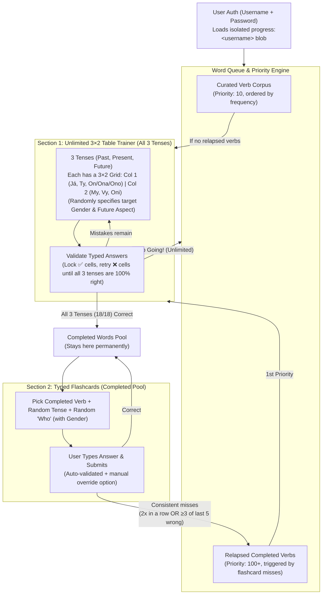

# Czech Verb Trainer — Implementation Plan

A fast, iPhone-first Progressive Web App (PWA) for mastering Czech verb conjugations, deployed on **Netlify** and backed by **Netlify Blobs** with **multi-user support (simple username & password)**. It features an **unlimited 3×2 Conjugation Table Trainer** (`Col 1: Já, Ty, On/Ona/Ono` | `Col 2: My, Vy, Oni`) across **all 3 tenses (Past, Present, Future)** where you keep going until every cell is right, paired with **Typed-Answer Flashcards** that automatically re-queue struggling completed words with higher priority.

---

## 1. Core Learning Loop & Mechanics



### Section 1: Unlimited 3×2 Table Trainer (All 3 Tenses)
* **Unlimited Continuous Practice:** No daily lock—as soon as you finish a word across all 3 tenses, it is added to your Completed list and you can immediately tap **"Next Word"** to keep going.
* **The 3×2 Conjugation Grid (Repeated for Past, Present, and Future):**
  Each word presents three **3×2 tables**—**Minulý čas (Past)**, **Přítomný čas (Present)**, and **Budoucí čas (Future)**:
  | Row | Column 1 (Singular) | Column 2 (Plural) |
  | :--- | :--- | :--- |
  | **1st Person** | **Já** *(random ♂ m. / ♀ f. in Past)* | **My** |
  | **2nd Person** | **Ty** *(random ♂ m. / ♀ f. in Past)* | **Vy** |
  | **3rd Person** | **On / Ona / Ono** *(randomly picks one)* | **Oni** |
* **Explicit Random Prompt Specification:**
  * **Gender (in Past Tense):** Each cell in Column 1 explicitly displays a randomly chosen gender badge for that run: e.g. `Já (♂)` or `Já (♀)`, `Ty (♂)` or `Ty (♀)`, and `On`, `Ona`, or `Ono`.
  * **Future / Aspect Target (in Future Tense):** Explicitly specifies whether the Future 3×2 table wants the **Imperfective Process Future** (`budu dělat`) or the **Perfective Completed Future** (`udělám`) for verbs that have an aspect pair.
* **"Until All Right" Mastery Loop:**
  * You can check a single tense table or all 3 tense tables at once.
  * Submitting locks in correct cells (`✅ Green`) and highlights wrong cells (`❌ Red/Amber`).
  * Pressing **Next / Enter** on the keyboard automatically jumps focus to the next unlocked cell.
  * You keep retrying only the incorrect cells until all **3 tenses × 6 cells (18/18)** are correct.
  * Once all 18/18 are right, the word is added to `completedVerbs` (and if it was a re-queued struggling word, its `inMatrixQueue` flag is cleared and its error streak resets).

### Section 2: Typed-Answer Flashcards & Priority Re-Queueing
* **Card Selection:** Pulls exclusively from the user's `completedVerbs`. Picks a word (weighted toward lower accuracy / older review) and randomly picks:
  * **Tense:** Past, Present, or Future (specifying Imperfective vs. Perfective for Future)
  * **Who:** `Já (♂/♀)`, `Ty (♂/♀)`, `On`, `Ona`, `Ono`, `My`, `Vy`, or `Oni`.
* **Typed Answer Grading:**
  * You type the conjugated form into an input box and hit **Enter / Done**.
  * The app auto-checks your answer against verified forms, shows the exact expected answer if wrong (with a *"Mark as Right anyway (typo)"* override button), and records the result.
* **Relapse / Priority Re-Queue Rule:**
  * Every completed verb tracks `consecutiveWrong` and a sliding window `last5Results: boolean[]`.
  * **Trigger Condition:** If `consecutiveWrong >= 2` **OR** `wrongCount(last5Results) >= 3`:
    1. The word **stays in `completedVerbs`** (never removed from your learned list or flashcard pool).
    2. `inMatrixQueue` is set to `true`.
    3. `priorityScore` jumps to `100 + (consecutiveWrong * 10) + errorRate` (compared to `10` for new unseen words).
  * Next time you load or advance in the Table Trainer, these high-priority relapsed words are served **first** before new words.

---

## 2. Word Sources & 100% Czech Morphological Accuracy

> [!WARNING]
> **Deterministic, Pre-Verified Forms Only**
> Live LLM generation is never used at runtime because LLMs frequently hallucinate Czech stem vowel lengths (*psát $\rightarrow$ píšu* vs *spát $\rightarrow$ spím*). Every verb form is deterministically pre-compiled and verified.

### Authoritative Sources
1. **Czech National Corpus (ČNK — SYN2020):** High-frequency Czech verbs ordered by real-world frequency so you learn the most useful verbs first (*být, mít, chtít, moct, vědět, muset, dát, jít, dělat, říct, vidět, myslet, pracovat, psát, číst, rozumět, mluvit, kupovat...*).
2. **ÚJČ (Internetová jazyková příručka) & Morfflex CZ Rules:** Verified in `scripts/verify-verbs.ts` across all 6 persons in Present, Past (masculine/feminine/neuter), and Future (imperfective `budu + inf` & perfective present-form).

### Smart Answer Validation
* **Spoken & Bookish Variants Accepted:** Accepts both spoken (`pracuju / pracujou`, `píšu / píšou`) and formal (`pracuji / pracují`, `píši / píší`).
* **Pronoun Flexibility:** Accepts `dělám` or `já dělám`.
* **Strict 2nd-Position Reflexive Clitics:** For reflexive verbs (*učit se*, *ptát se*, *smát se*), properly enforces Czech 2nd-position clitic rules in the past tense (`učil jsem se` / `já jsem se učil`, rejecting `*učil se jsem`).
* **Keyboard & On-Screen Accent Bar:** One-tap buttons for `á č ď é ě í ň ó ř š ť ú ů ý ž` that insert directly at the cursor position without dismissing the mobile keyboard.

---

## 3. iPhone PWA & Mobile-First Experience

### iOS Home Screen Web App (PWA) Configuration
* **Web App Manifest (`public/manifest.webmanifest`):**
  * `display: "standalone"`, `orientation: "portrait"`, `theme_color` & `background_color` matched to the app header/background for a seamless full-screen look.
  * App icons at `192×192`, `512×512` (maskable + standard), and `180×180` (`apple-touch-icon.png`).
* **iOS Safari Meta Tags (`index.html`):**
  * `<meta name="apple-mobile-web-app-capable" content="yes">`
  * `<meta name="apple-mobile-web-app-status-bar-style" content="black-translucent">`
  * `<meta name="apple-mobile-web-app-title" content="Čeština">`
  * `<meta name="viewport" content="width=device-width, initial-scale=1, maximum-scale=1, user-scalable=no, viewport-fit=cover">`
* **Offline-Capable Service Worker (`public/sw.js`):**
  * Pre-caches the app shell and `verbs.json` so launching from the iPhone Home Screen is instant and works offline, syncing queued progress to Netlify Blobs when connectivity returns.
* **"Save as App (PWA)" Pop-up Modal (`IosInstallBanner.tsx`):**
  * Automatically appears as a pop-up modal when opened in a regular browser (`!isRunningStandalonePwa()`) and can also be reopened anytime via the **"Save as App"** button in the header.
  * Includes brief, step-by-step instructions for **iPhone / iPad (Safari)** (`Tap Share` $\rightarrow$ `Add to Home Screen` $\rightarrow$ `Add`) as well as **Android / Chrome** (including a 1-click native `beforeinstallprompt` install button when available).

### Ergonomic Mobile UX Details
* **Responsive Tense Switcher on Mobile:**
  * On desktop (`lg:`), all 3 tense 3×2 tables (Past, Present, Future) display side-by-side.
  * On iPhone screens, a segmented tense pill bar (**Minulý • Přítomný • Budoucí** with live `0/6` completion badges) lets you focus on one 3×2 grid at a time without endless scrolling while the iOS keyboard is open, automatically advancing to the next incomplete tense when a 6-cell table is completed.
* **iOS Keyboard & Input Hygiene:**
  * All conjugation inputs enforce `font-size: 16px` (`text-base`) so iOS Safari never triggers unwanted auto-zoom on focus.
  * All inputs set `autoCapitalize="none"`, `autoCorrect="off"`, `autoComplete="off"`, `spellCheck={false}`, and `enterKeyHint="next"` (or `"done"` on the final cell).
* **Non-Blurring Sticky Czech Accent Bar:**
  * Docked above the keyboard/bottom navigation using `onPointerDown={(e) => e.preventDefault()}` so tapping `ř`, `ě`, `ž`, `ů`, etc. inserts the character into the currently focused cell **without blurring the input or closing the iOS keyboard**.
* **Safe Area & Dynamic Viewport (`100dvh`):**
  * Respects `env(safe-area-inset-top)` (Dynamic Island / notch) and `env(safe-area-inset-bottom)` (Home Indicator bar) with a bottom tab bar for thumb-friendly navigation (**Table Trainer**, **Flashcards**, **My Words**).

---

## 4. Multi-User Authentication & Netlify Blobs Architecture

### Simple Username & Password Auth
* **Explicit Sign In / Create Account Flow (`AuthView.tsx`):**
  * Simple `username` (normalized lowercase, `[a-z0-9_-]{3,24}`) and `password` (`min 4 chars`).
  * Separate **Sign In** and **Create Account** modes so a typo in username never accidentally creates a blank account.
* **Zero-Dependency Serverless Crypto (`netlify/functions/auth.mts`):**
  * Passwords hashed using Node's native `crypto.scryptSync(password, salt, 64)` with a per-user 16-byte random salt and verified via `crypto.timingSafeEqual`.
  * Stateless HMAC-SHA256 session token (`<username>.<issuedAt>.<signature>`) signed with `process.env.AUTH_SECRET` (with a deterministic fallback for zero-config deployments) stored in `localStorage` and passed via `Authorization: Bearer <token>`.
* **Multi-User Isolation & Account Switching:**
  * Each user's progress is stored in their own isolated Netlify Blob (`progress:<username>`) and cached locally under `czech_trainer_progress:<username>`.
  * Header displays the active `@username`, sync status badge, and a **Log Out / Switch User** button.

### Netlify Blobs Schema (`czech-trainer-store`)

1. **User Auth Record (`user:<username>`):**
```typescript
interface UserAuthRecord {
  username: string;       // normalized lowercase, e.g. "liam"
  displayName: string;    // original casing, e.g. "Liam"
  passwordHash: string;   // hex-encoded scrypt hash
  salt: string;           // hex-encoded 16-byte salt
  createdAt: string;
}
```

2. **Per-User Progress Record (`progress:<username>`):**
```typescript
interface UserProgressBlob {
  version: 1;
  username: string;
  updatedAt: string;
  stats: {
    currentStreak: number;
    lastActiveDate: string | null; // "YYYY-MM-DD"
    tablesCompletedToday: number;
    totalTablesCompleted: number;
    activeSession: {
      verbId: string;
      futureMode: "impf" | "pf";
      genders: { ja: "m" | "f"; ty: "m" | "f"; thirdSg: "on" | "ona" | "ono" };
      lockedCells: Record<string, string>; // e.g. { "present:ja": "píšu", "past:my": "psali jsme" }
    } | null;
  };
  verbs: Record<string, VerbUserRecord>;
}

interface VerbUserRecord {
  verbId: string;              // e.g. "psat"
  completed: boolean;          // true once all 3 tenses' 3x2 tables passed at least once
  firstCompletedAt: string;
  lastTableCompletedAt: string;
  tableCompletionsCount: number;

  // Priority Re-Queue State
  inMatrixQueue: boolean;      // true when new OR when relapsed from flashcards
  priorityScore: number;       // 10 = new, 100+ = relapsed high-priority

  // Flashcard Performance State
  flashcards: {
    totalAttempts: number;
    totalCorrect: number;
    consecutiveWrong: number;
    last5Results: boolean[];   // sliding window of last 5 attempts
    lastReviewedAt: string | null;
    weakPrompts: Record<string, number>; // e.g. { "past:ja_f": 2, "present:oni": 3 }
  };
}
```

---

## 5. Proposed Directory Structure

```text
/Users/liam/Documents/GitHub/czech-game/
├── index.html                    # iOS PWA meta tags, apple-touch-icon, viewport-fit=cover
├── netlify.toml                  # Build config, functions directory, SPA routing & PWA headers
├── package.json
├── public/
│   ├── manifest.webmanifest      # Standalone PWA manifest
│   ├── sw.js                     # Service Worker for offline shell & asset caching
│   ├── apple-touch-icon.png      # 180x180 iOS Home Screen icon
│   ├── icon-192.png              # 192x192 PWA icon
│   └── icon-512.png              # 512x512 PWA icon
├── scripts/
│   └── verify-verbs.ts           # Validates all verb forms & clitic rules in verbs.json
├── netlify/
│   └── functions/
│       ├── _auth.ts              # Shared scrypt password hashing & HMAC token verification
│       ├── auth.mts              # POST /api/auth (login, register, verify session)
│       └── progress.mts          # GET/POST /api/progress (reads/writes progress:<username> blob)
└── src/
    ├── data/
    │   └── verbs.json            # Curated, verified Czech verb dataset with aspect pairs & mnemonics
    ├── lib/
    │   ├── priorityQueue.ts      # Picks next verb (relapsed priority > 100 first, then frequency order)
    │   ├── validator.ts          # Validates Czech forms, clitics, diacritics, and variants
    │   └── api.ts                # Auth + per-user sync with Netlify Blobs (and per-user localStorage cache)
    ├── components/
    │   ├── AuthView.tsx          # Clean Login / Create Account screen
    │   ├── TableTrainerView.tsx  # 3x2 grids across Past, Present, Future + mobile tense tabs + retry loop
    │   ├── FlashcardView.tsx     # Typed-answer flashcard drill on completed words + relapse trigger
    │   ├── CompletedListView.tsx # View completed words, accuracy %, and "Re-queued (High Priority)" badges
    │   ├── AccentBar.tsx         # Non-blurring Czech diacritic bar docked above mobile keyboard
    │   └── IosInstallBanner.tsx  # Dismissible "Add to Home Screen" instructions for iPhone Safari
    └── App.tsx
```

---

## 6. Verification Plan
1. **Verb Corpus Verification:** Run `npx tsx scripts/verify-verbs.ts` to validate every verb's 6 persons across Present, Past (m/f/n), and Future (imperfective & perfective).
2. **Priority Re-Queue Tests:** Verify that failing a completed word in Flashcards (2 consecutive misses or 3/5 misses) keeps it in `completedVerbs` while flagging `inMatrixQueue = true` with `priorityScore >= 100` so it appears next in the Table Trainer.
3. **Multi-User Auth & Isolation Check:** Verify creating two separate accounts (`userA`, `userB`), confirming password hashing, session token validation, and isolated progress blobs (`progress:userA` vs `progress:userB`).
4. **iPhone PWA & Mobile UX Check:** Verify `manifest.webmanifest`, iOS standalone meta tags, `16px` input font sizing (no Safari auto-zoom), non-blurring `AccentBar` character insertion, and mobile tense tab navigation.
5. **Build & Netlify Function Check:** Run `npm run build` and verify clean production bundle output.
